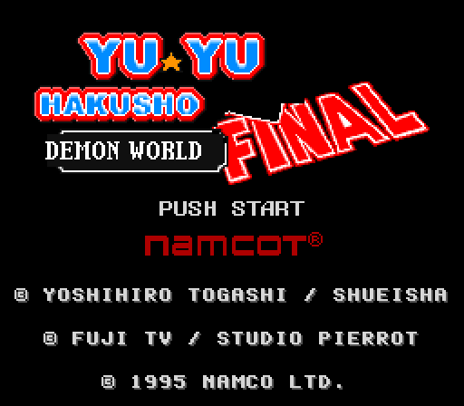
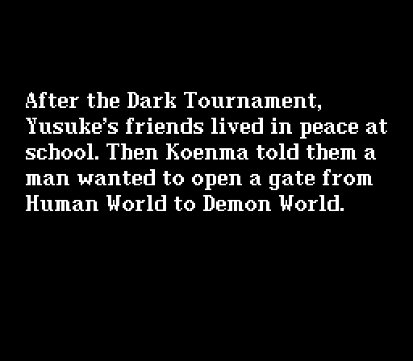
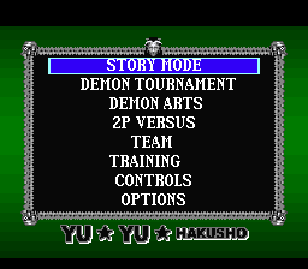
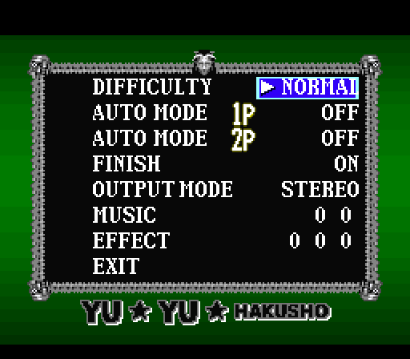
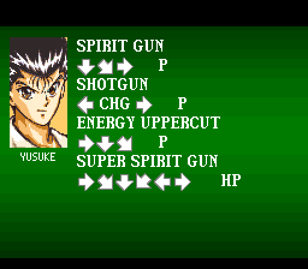
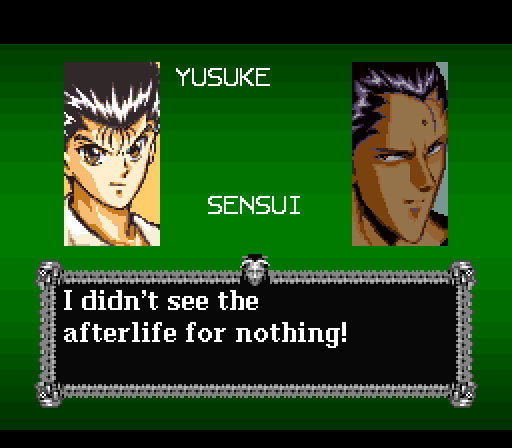

# Yu Yu Hakusho Final: Makai Saikyou Retsuden — English Translation

English translation and presentation patch for **Yu Yu Hakusho Final: Makai Saikyou Retsuden** on the Super Famicom / SNES, by Retch.

**Latest: v1.1** — [download `yu_yu_hakusho_final_eng_v11.zip`](yu_yu_hakusho_final_eng_v11.zip) or grab it from [Releases](../../releases)

| | |
|---|---|
|  |  |
|  |  |
|  |  |

## What's new in v1.1

**New font**
- New proportional serif font for all in-game text, drawn in the style of the game's own lettering
- Letters take only the width they need, so lines read naturally instead of in fixed 8-pixel steps
- Capital I and lowercase l are easy to tell apart

**Title screen**
- English title logo: YU YU HAKUSHO with the original FINAL, in the same red, white and blue style
- English subtitle plate and English copyright lines

**Story**
- All 71 story pages re-set with the new font and rewrapped with balanced lines
- Fixed words that ran together at line breaks (hasalready, hopeto, fornow, leftfor, powerlevels, World'sthree, helphim)
- Small grammar fixes on five pages; curly quotes and apostrophes

**Menus and screens**
- Main menu, Options, Controls, Training, mode select, Pick Fighter, Pick Team and team labels redone in one font with consistent alignment
- Fixed the EASY and NORMAL difficulty names, which showed as garbled letters
- Option values and sound test counters use the new font; SOUND MODE is now OUTPUT MODE
- Controls read LO PUNCH, HI PUNCH, LO KICK and HI KICK at full size
- Continue screen and post-fight score tally redone; every number on screen uses the same digits

**Move lists**
- All 14 move lists redone with the new font; the game's own arrow icons are kept
- Fixed corrupted move names: Gatling Stomp, Machine Gun Knuckle, Radiant Fist, Radiant Strike, Spirit Cannon, Ring Storm, Nether Blast, Energy Strike, Leaf Storm
- Added missing details: Double Red Ball Shot, Air Spirit Gun (in the air), Twin Dragons (life 1/10)

**Battles and tournament**
- All 40 battle-result quotes re-set in sentence case and wrapped to fit the box
- Demon Tournament bracket round names, ranks, match labels, total points and the ending line translated
- Victory lines that were still in Japanese now use the English story lines

**Ending credits**
- Credits redrawn with a clean font (proper A and S); dual roles marked as YUSUKE/MAJIN and KURAMA/YOKO

## How to patch

1. Get a clean, unheadered Japanese ROM of *Yu Yu Hakusho Final: Makai Saikyou Retsuden* (3,145,728 bytes)
2. Apply `yu_yu_hakusho_final_eng_v11.ips` with [Floating IPS](https://www.smwcentral.net/?p=section&a=details&id=11474) or another IPS patcher
3. Play in bsnes (recommended), another accurate SNES emulator, or on hardware

The patched ROM is 4 MB (4,194,304 bytes); the extra space holds the new text graphics.
Patched ROM SHA-1: `73F3B04DDCCF8A5FDD2349A3C6407DD1BC68761A`

v1.1 is cumulative: apply it to the clean Japanese ROM, not on top of v1.0.

## Credits

- English Translation, ROM Hack, and Presentation: Retch
- Original Game: Namco and the Yu Yu Hakusho Final development team
- Original Manga: Yoshihiro Togashi

Unofficial, noncommercial fan translation, not affiliated with or endorsed by the rights holders. No ROM is included; you must supply your own legally obtained copy.
